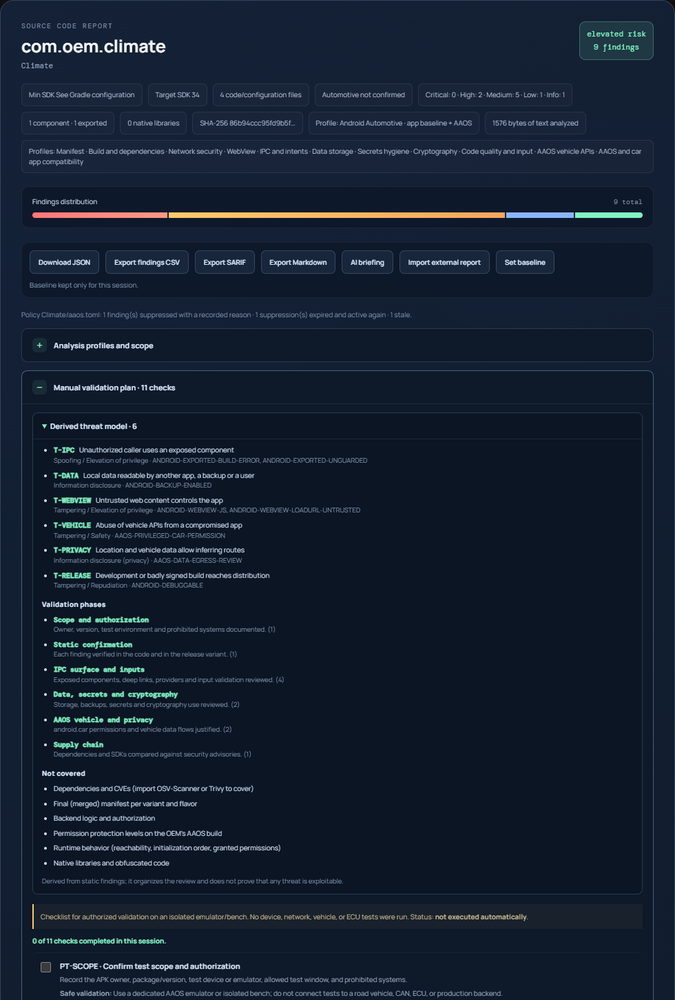
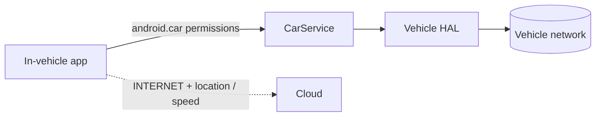
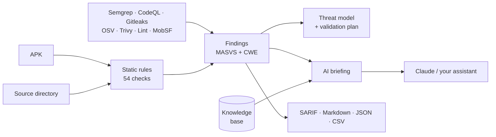

<div align="center">

# 🚗 AAOS Security Auditor

### AI-assisted security analysis for **Android Automotive OS**, built static-first, with a pentest workflow that is growing

Find what matters in an in-vehicle app **before it reaches the road**: reproducible findings mapped to OWASP MASVS and CWE, an AAOS-aware threat model, and an AI briefing your assistant can act on. All without running the app.


</div>

> **Defensive and authorized by design.** Static analysis only. No app execution, fuzzing, traffic interception, or contact with devices, vehicles, CAN buses or ECUs. Use it only on software you are authorized to assess.

<p align="center">
  
</p>

---

## Why this exists

Cars now run Android. An AAOS app is not "just an Android app": it sits on a path that reaches vehicle functions, handles location and speed, and ships on hardware that is slow to patch.



Generic mobile scanners know nothing about that chain. This tool does: it flags privileged `android.car` permissions, vehicle API usage, and the quiet privacy risk of location and vehicle data leaving the car, then hands the result to an AI that has been given the right context and the right guardrails.

## What you get

| | |
| --- | --- |
| 🔎 **54 deterministic rules** | Manifest, network, WebView, IPC, storage, crypto, secrets, build and AAOS checks. Evidence is always `path:line`, never code or secret values |
| 🚘 **AAOS-aware profile** | Automotive feature declaration, privileged `android.car` permissions, vehicle API references, Car App Library, vehicle-data egress review |
| 🧭 **MASVS + CWE on every finding** | Triage by standard, with a per-control summary in each report |
| 🧩 **7 scanner connectors** | Merge Semgrep, SARIF/CodeQL, Gitleaks, OSV-Scanner, Trivy, MobSF and Android Lint into one report |
| 🛡️ **Derived threat model** | Attack surface, STRIDE threats and a 7-phase manual validation plan |
| 🤖 **AI-ready by default** | A sanitized Markdown briefing for Claude or any assistant, hardened against prompt injection |
| 🧠 **Curated knowledge base** | 33 notes retrieved per rule, with MASVS, CWE and primary sources |
| ⚙️ **CI-ready CLI** | SARIF for GitHub code scanning, `--fail-on`, baselines that gate only on *new* findings, stable fingerprints |
| 🗂️ **Project policy** | `aaos.toml` with settings and **justified, expiring suppressions**, plus inline `aaos-ignore` comments |
| 🧰 **Claude Code skills** | Triage, remediation, CI gate, threat modeling and rule authoring |

## How it works



A real run on a small sample project:

```text
$ python -m app.cli ./Proj --format markdown

| Severity | Rule                           | Title                                     | MASVS                            | CWE     |
| -------- | ------------------------------ | ----------------------------------------- | -------------------------------- | ------- |
| high     | ANDROID-DEBUGGABLE             | Manifest allows debugging                 | MASVS-RESILIENCE-4, MASVS-CODE-4 | CWE-489 |
| medium   | AAOS-PRIVILEGED-CAR-PERMISSION | Sensitive vehicle permissions requested   | MASVS-PRIVACY-1, MASVS-PLATFORM-1|         |
| medium   | ANDROID-WEAK-CIPHER            | Weak cipher algorithm or mode             | MASVS-CRYPTO-1                   | CWE-327 |
| low      | AAOS-DATA-EGRESS-REVIEW        | Vehicle/location data with network access | MASVS-PRIVACY-1, MASVS-NETWORK-1 |         |
```

## Quick start

Requires **Python 3.11+**.

```powershell
# Windows (PowerShell)
python -m venv .venv
.venv\Scripts\Activate.ps1
pip install -r requirements.txt
uvicorn app.main:app --reload          # open http://127.0.0.1:8000
```

```bash
# macOS / Linux
python3 -m venv .venv && source .venv/bin/activate
pip install -r requirements.txt
uvicorn app.main:app --reload
```

No server needed for the CLI:

```bash
python -m app.cli ./android --profile aaos                       # full JSON report
python -m app.cli ./android --format sarif -o aaos.sarif         # GitHub code scanning
python -m app.cli ./android --baseline baseline.json --fail-on high   # CI gate on new findings only
```

## 🤖 Android Automotive meets AI

AI is optional, and it is only as good as what you feed it. This project builds that input carefully.

**The briefing.** `--format ai-context` produces one Markdown document: scope, severity counts, findings grouped by root cause with MASVS and CWE, applicable AAOS threats, curated notes, what was *not* covered, and explicit response instructions.

```bash
python -m app.cli ./android --import semgrep.json --import osv.json --format ai-context -o briefing.md
python -m app.cli ./android --format ai-context --no-locations     # safe for a third-party service
```

**Two ways to use it**

| Mode | What happens | What the model sees |
| --- | --- | --- |
| **Server advisor** (Claude or an OpenAI-compatible endpoint) | The report page gets an AI summary with priorities, fixes, probable false positives and validation steps | Rule-level facts only. No code, no APK, no secrets, no paths or lines |
| **Your own assistant** (for example Claude Code) | You export the briefing with `path:line` and let the assistant open files locally | Whatever you choose to share |

**Guardrails built in**

- 🔒 Findings never carry code excerpts or secret values.
- 🧱 Text from scanners and projects is **untrusted**. Headings, code fences, HTML and quote blocks are neutralized, and the briefing says its content is data, not instructions.
- 🚫 The prompt forbids exploit payloads and tests on real vehicles, CAN or ECUs.

**Enable the advisor** by copying `.env.example` to `.env`:

```env
AI_PROVIDER=anthropic          # or openai-compatible
AI_MODEL=<a model available to your account>
AI_API_KEY=<your key>
```

Claude needs an Anthropic Console API key with billing. The key stays server-side.

## 🧪 Pentest workflow, evolving

Pentesting here means **structured, authorized, manual validation guided by static evidence**. Active exploitation is intentionally out of scope for now (see the [research](docs/ai-pentest-landscape.md) on tools such as PentestGPT, Strix and PentAGI, and what was adopted or excluded).

| Stage | Status | What it is |
| --- | --- | --- |
| Static findings with MASVS and CWE | ✅ Available | Reproducible evidence, no execution |
| Threat model (STRIDE, AAOS chain, privacy) | ✅ Available | Derived from findings, with what is *not* covered |
| Phased validation plan (7 phases, task state) | ✅ Available | Scope, static confirmation, IPC, network, data and crypto, AAOS vehicle and privacy, supply chain |
| Scanner fusion and dependency CVEs | ✅ Available | Semgrep, CodeQL, Gitleaks, OSV, Trivy, Lint, MobSF |
| AI triage and remediation skills | ✅ Available | Claude Code skills with evaluation cases |
| Per-rule MASTG test and MASWE weakness IDs | 🔜 Next | Needs verification against official sources |
| Emulator lab for dynamic checks (opt-in, isolated) | 🧭 Planned | Separate stage, AAOS emulator only |
| Authentication, audit log, rate limits | 🧭 Planned | Required before any shared deployment |

The validation plan ships as a checklist for an **isolated AAOS emulator or bench**, never a road vehicle:

```text
1 Scope           PT-SCOPE
2 Static confirm  PT-DEBUG · PT-PLATFORM
3 IPC             PT-EXPORTED · PT-DEEPLINKS · PT-PROVIDER · PT-WEBVIEW-URL · PT-SQL
4 Network / TLS   PT-NETWORK · PT-NSC-TRUST · PT-TLS
5 Data / crypto   PT-DATA · PT-BACKUP · PT-CRYPTO · PT-SECRETS
6 AAOS            PT-AAOS-API · PT-AAOS-PERMS · PT-PRIVACY-EGRESS
7 Supply chain    PT-DEPENDENCIES
```

## 🚘 AAOS detection highlights

| Check | Why it matters |
| --- | --- |
| `AAOS-PRIVILEGED-CAR-PERMISSION` | Table-driven from the **AOSP protection levels** of all 156 `android.car` permissions. `signature\|privileged` ones (for example `CONTROL_CAR_CLIMATE`) are never granted to a normal third-party app, so the finding explains when it matters; `dangerous` ones (for example `CAR_SPEED`) *can* be granted and feed the privacy review |
| `AAOS-VEHICLE-API-REVIEW` | `android.car` and `CarPropertyManager` usage to validate per API, property and OEM |
| `AAOS-DATA-EGRESS-REVIEW` | INTERNET plus location or vehicle data can reveal routes and habits |
| `AAOS-FEATURE-UNCONFIRMED` | Missing `android.hardware.type.automotive` declaration |
| `AAOS-CAR-APP-LIBRARY` | Android Auto, AAOS or both: different environments and requirements |
| `ANDROID-SHARED-USER-ID` | Common in OEM system apps; review privilege scope and IPC surface |

Plus the general Android set: debuggable and test-only builds, backup, exported components, cleartext and Network Security Config, WebView settings, PendingIntent and FileProvider, SharedPreferences credentials, weak crypto, SQL concatenation, dynamic code loading and release hardening. Print the full catalog with `python -m app.cli --list-rules`.

## Connectors

Run the tool in your own authorized environment, then import the report. Format is auto-detected.

| Tool | Format | Command |
| --- | --- | --- |
| Semgrep | JSON | `semgrep scan --config auto --json --output semgrep.json <dir>` |
| Semgrep / CodeQL | SARIF 2.1 | `semgrep scan --config auto --sarif --output findings.sarif <dir>` |
| Gitleaks | JSON | `gitleaks detect --source <dir> --report-format json --report-path gitleaks.json --redact` |
| OSV-Scanner | JSON | `osv-scanner scan --format json --output osv.json <dir>` |
| Trivy | JSON | `trivy fs --format json --output trivy.json <dir>` |
| Android Lint | XML | `./gradlew lintRelease` |
| MobSF | JSON | Export the static analysis report |

Only rule ID, severity, CWE, confidence and `path:line` (or `package@version`) are kept. **Messages, excerpts, matched text and secret values are discarded.** SARIF suppressions are skipped, absolute paths are trimmed to project-relative, and Lint XML with `DOCTYPE`/`ENTITY` is refused.

## Project policy and suppressions

Real projects have known false positives and accepted risks. Put a policy file named `aaos.toml` at the project root (see [examples/aaos.toml](examples/aaos.toml)); the CLI and the web app find it automatically.

```toml
[settings]
fail_on = "high"
ignore_paths = ["**/src/test/**"]
disabled_rules = ["ANDROID-HTTP-URL"]

[[suppress]]
rule = "ANDROID-WEAK-HASH"
path = "app/src/main/java/ImageCache.kt"
reason = "MD5 is only used to build cache keys, never for security"
author = "ivo"
expires = 2027-01-01
```

Suppressions are designed so that a decision is never hidden:

- A **reason is mandatory**; entries without one are skipped with a warning.
- They can **expire**. An expired entry stops applying and the finding returns, and the report says so.
- **Stale entries** that match nothing are reported.
- Suppressed findings are kept in the report (`suppressed_findings`) with their reason, shown in the Markdown export, emitted as native **SARIF `suppressions`** with the justification, and passed to the AI briefing so it does not re-raise them.
- A **broken `aaos.toml` never hides findings**: the CLI exits with code `2`, and the web app reports a warning and keeps every finding.
- Inline form: `// aaos-ignore[RULE-ID]: reason` on the flagged line or the line above. In `AndroidManifest.xml`, one comment anywhere in the file covers that rule for the file.

**Stable fingerprints.** Every finding has a `fingerprint` that survives line shifts and never depends on a secret's value. Baselines compare by fingerprint, so moving code around does not create false "new" findings, and SARIF carries it as `partialFingerprints` so GitHub code scanning keeps alerts open instead of recreating them.

## Claude Code skills

Open Claude Code at the repo root:

| Skill | Use it to |
| --- | --- |
| `aaos-source-audit` | Scan an authorized directory and explain findings with evidence |
| `aaos-finding-triage` | Group, verify and classify: confirmed, likely, needs-runtime, false positive |
| `aaos-threat-model` | Merge scanner reports, build the briefing and the validation plan |
| `aaos-remediation` | Apply minimal fixes and prove them with a baseline re-scan |
| `aaos-ci-gate` | Add SARIF upload and severity gates to GitHub Actions or pre-commit |
| `aaos-rule-authoring` | Add or tune a rule with MASVS, CWE, notes, tests and docs |

Each ships with evaluation cases. Dynamic-action skills (Frida, objection) were deliberately not installed.

## CLI reference

| Option | Effect |
| --- | --- |
| `--profile aaos\|android_app` | Rule profile (default `aaos`) |
| `--format json\|sarif\|markdown\|ai-context` | Output format |
| `-o <file>` | Write UTF-8 output to a file |
| `--import <report>` | Merge an external report (repeatable) |
| `--baseline <report.json>` | Compare with an earlier report; with `--fail-on`, only new findings count |
| `--fail-on <sev>` | Exit `1` at or above a severity |
| `--min-severity <sev>` | Hide lower severities in the output |
| `--no-locations` | `ai-context`: omit `path:line` |
| `--config <file>` · `--no-config` | Use a specific policy file, or ignore `aaos.toml` |
| `--list-rules` · `--list-connectors` · `--check-knowledge` | Inspect catalog, formats, notes |

Exit codes: `0` ok, `1` gate failed, `2` input error.

## HTTP API

Interactive docs at `/docs`.

| Endpoint | Purpose |
| --- | --- |
| `POST /api/analyze` · `POST /api/analyze-directory` | Analyze an APK or a source directory |
| `POST /api/connectors/import-static-report` · `GET /api/connectors` | Import an external report; list formats |
| `POST /api/export/{sarif\|markdown\|ai-context}` | Convert a report |
| `POST /api/threat-model` | Recompute the threat model |
| `GET /api/rules` · `GET /api/knowledge` | Rule catalog; knowledge lookup |
| `GET /api/health` | Status |

## Knowledge base

`knowledge/security_notes.json` holds 33 curated notes with `rule_ids` (exact IDs, globs such as `ANDROID-PERM-*`, or `*`), `masvs`, `cwe` and `references`. Retrieval is capped at 6,000 characters and ranked by the worst matching finding, so the highest-impact guidance is never cut. Validate with `python -m app.cli --check-knowledge`; use your own file with `AAOS_KNOWLEDGE_FILE`.

## Project layout

```text
app/        FastAPI app, CLI, scanners, connectors, MASVS/CWE mapping,
            threat model, AI briefing and advisor, exporters, web UI
knowledge/  Curated security notes
docs/       Research notes (AI pentest landscape)
tests/      113 tests
.claude/    Claude Code skills
```

## Development

```bash
pip install pytest
pytest
```

The suite fails if a rule has no MASVS mapping or no knowledge note, so new rules cannot ship half-wired.

## Limits

- Heuristic results. A flagged permission or component is context for review, not proof of exploitation, and this is not a MASVS certification.
- Directory analysis does not run Gradle, resolve version catalogs or variants, inspect binaries, or see the merged manifest. Confirm findings against the real build.
- Uploads pass through process memory and are not persisted. Do not expose the server publicly without authentication, TLS and rate limits.
- Connectors import exported static results only.

## License

Released under the [MIT License](LICENSE). The bundled `community-android-security` skill is adapted from a third-party MIT-licensed project; its original license and notice are preserved in `.claude/skills/community-android-security/`.

## Contributing

Ideas and rules are welcome, especially AAOS-specific checks and real-world false-positive reports. Start with the `aaos-rule-authoring` skill, which lists every file a rule touches.

---

<div align="center">

Built for people who ship software into vehicles and want to find problems early, safely and with context.

</div>
